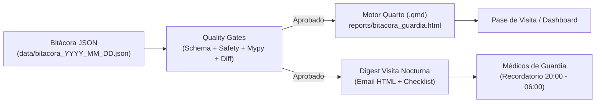

# 🏥 Bitácora Médica de Guardia & Agente Clínico Antigravity

Sistema integral de gestión de guardia hospitalaria (Medicina Interna, Reumatología, Infectología, Periféricos y Emergencia). 
Transforma la bitácora manual en un **instrumento dual sincronizado**:
1. **JSON Estructurado (SSOT - Single Source of Truth):** Esquema canónico validado con Pydantic v2 para trazabilidad, diffs automáticos y consumo por APIs.
2. **Dashboard Clínico Quarto (.qmd):** Reporte interactivo con pestañas por servicio, badges visuales de alerta (alergias, función renal, antibióticos) y un checklist ejecutivo para la visita médica.
3. **Recordatorios de Visita Nocturna (Email Digest):** Extracción automatizada y despacho de pendientes críticos (STAT, urgentes, cultivos, controles 05:00 AM) para los residentes de guardia.
4. **Suite de Quality Gates:** Validación de tipos estricta (`mypy`), diff de integridad clínica, verificación de días de antibióticos e inspección de seguridad del paciente.

---

## 🚀 Arquitectura y Flujo Operativo



---

## 🛠️ Instalación y Configuración con `uv`

Este proyecto utiliza el gestor ultra-rápido `uv`:

```bash
# Crear entorno virtual y activar
uv venv
.venv\Scripts\activate   # Windows

# Instalar dependencias en modo editable con herramientas de desarrollo
uv pip install -e .[dev]
```

---

## 📋 Comandos del Agente CLI

El ejecutable `bitacora` (o mediante `uv run bitacora`) ofrece los siguientes comandos:

```bash
# 1. Validar integridad de una bitácora
uv run bitacora validate data/bitacora_2026_11_09.json

# 2. Generar reporte Quarto (.qmd) y compilar Dashboard HTML
uv run bitacora render data/bitacora_2026_11_09.json --html

# 3. Extraer pendientes nocturnos y generar correo de guardia (Dry-run o envío real)
uv run bitacora notify-night data/bitacora_2026_11_09.json --dry-run
uv run bitacora notify-night data/bitacora_2026_11_09.json --send --to guardia@hospital.org

# 4. Analizar Diff Clínico entre dos turnos consecutivos (altas, ingresos, pendientes resueltos)
uv run bitacora diff data/bitacora_2026_11_09.json data/bitacora_2026_11_10.json

# 5. Ejecutar Quality Gates completos (Schema + Seguridad Clínica + Diff + Mypy)
uv run bitacora gate-check data/bitacora_2026_11_10.json --anterior data/bitacora_2026_11_09.json

# 6. Exportar JSON Schema para integraciones externas
uv run bitacora schema-export
```

---

## 🧪 Ejecución de Tests y Gates

```bash
# Correr suite de pruebas unitarias
uv run pytest

# Correr verificación estricta de tipos mypy
uv run mypy src

# Correr linter ruff
uv run ruff check src
```

---

## ☁️ Ejecución Automatizada en la Nube / Antigravity

El script `scripts/run_night_round_agent.py` está diseñado para programarse vía `/schedule` o cron diario en la nube de Antigravity (a las 19:30 o 20:00 hora local):
1. Carga la bitácora del día.
2. Corre los Quality Gates.
3. Compila el reporte Quarto interactivo.
4. Extrae los pendientes y transmite el recordatorio por email a los médicos de guardia.

